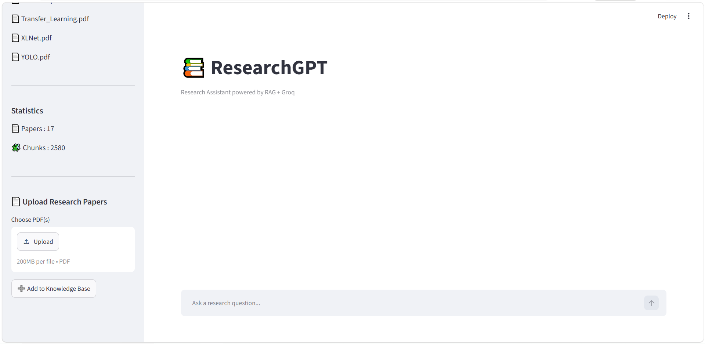
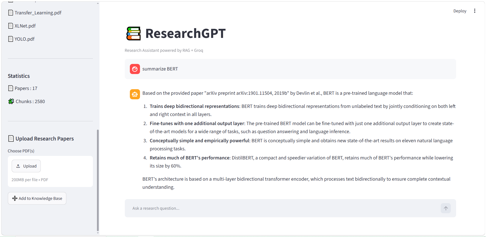
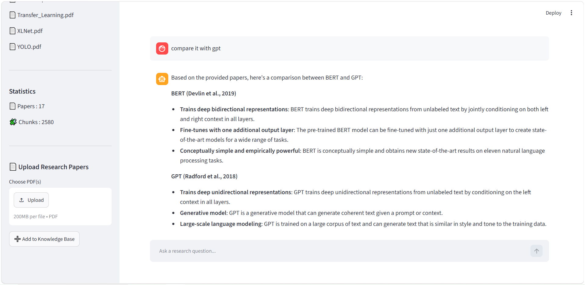

# 📚 ResearchGPT

A production-style **Retrieval-Augmented Generation (RAG)** system that answers questions directly from research papers using semantic search, cross-encoder re-ranking, conversation memory, and Large Language Models.

ResearchGPT supports **dynamic PDF uploads**, allowing users to extend the knowledge base without rebuilding the entire project.

Built with **LangChain, FAISS, HuggingFace Embeddings, Groq LLMs, Streamlit, and Docker.**

---

# Features

- 📄 Multi-PDF Research Paper Question Answering
- 📂 Dynamic PDF Upload & Knowledge Base Expansion
- 🧠 Retrieval-Augmented Generation (RAG)
- 🔍 FAISS Vector Database
- 🤗 HuggingFace Sentence Transformers Embeddings
- 💬 Conversation Memory
- 📑 Source Citations with Page References
- 🎯 MMR Retrieval
- ⚡ Cross-Encoder Re-ranking (ms-marco-MiniLM-L6-v2)
- 📊 Research Paper Comparison Mode
- 🧭 Paper-Aware Query Routing (retrieval restricted to the papers named in the question)
- 🔁 Follow-up Question Rewriting & Retry on Empty or Refused Answers
- 🚫 Refuses Questions the Papers Cannot Answer
- 📈 Evaluation Pipeline with LLM-Judge Grading and a Retrieval Ablation (semantic similarity kept as a legacy score)
- 🌐 Streamlit Web Interface
- 🐳 Dockerized Application
- ⚙️ GitHub Actions CI/CD (syntax check, Docker build & push to Docker Hub)

---

# Tech Stack

| Component | Technology |
|------------|------------|
| LLM | Groq (openai/gpt-oss-20b) |
| Framework | LangChain |
| Vector Database | FAISS |
| Embeddings | Sentence Transformers |
| Re-ranking | ms-marco-MiniLM-L6-v2 |
| Retrieval Routing | 30-paper catalogue with aliases + PaperAwareRetriever |
| Frontend | Streamlit |
| Evaluation | LLM judge (openai/gpt-oss-120b via Groq), numeric check, Scikit-Learn similarity (legacy) |
| Containerization | Docker |
| CI/CD | GitHub Actions |

---

# Results

### Evaluation Benchmark

- ✅ Evaluated on **100 questions over 30 research papers** (direct, summary, comparison, follow-up and not-found questions)
- ✅ Answers graded by an **LLM judge** (`openai/gpt-oss-120b`) against reference answers, plus an automatic check that the numbers in short reference answers appear in the answer
- ✅ **75% strictly correct, 83% when partial answers count half**
- ✅ **15/15 unanswerable questions correctly refused**, with 0 wrong refusals on the 85 answerable questions
- ✅ Supports multi-document reasoning across research papers

### Results by Question Type (30 papers, 100 questions)

| Category | n | Correct | Partial | Wrong | Strict | Lenient |
|---|---|---|---|---|---|---|
| direct | 42 | 35 | 2 | 5 | 83% | 86% |
| summary | 12 | 4 | 8 | 0 | 33% | 67% |
| comparison | 16 | 10 | 5 | 1 | 62% | 78% |
| follow_up | 15 | 11 | 1 | 3 | 73% | 77% |
| not_found | 15 | 15 | 0 | 0 | 100% | 100% |
| **ALL** | **100** | **75** | **16** | **9** | **75%** | **83%** |

*strict = correct only; lenient = partial answers count half. "Wrong" counts everything that is neither correct nor partial, including 2 answers the judge marked correct that missed a number from the reference (the judge's own verdicts are 77 correct / 16 partial / 7 wrong). Summary answers are mostly incomplete (8 partial, 0 wrong) rather than incorrect.*

The original similarity score (all-MiniLM-L6-v2 cosine similarity ≥ 0.70) is kept as a legacy column: 77/100 on this set, but it is threshold-sensitive (91% at ≥ 0.60 down to 53% at ≥ 0.80) and disagrees with the judge on 34 of the 100 questions, so it is not used as the headline metric.

Per-question results are in [`evaluation/results_judged.csv`](evaluation/results_judged.csv) and the summary is in [`evaluation/result_v1.md`](evaluation/result_v1.md).

### Retrieval Ablation (30 papers, 70 questions with a gold paper)

| Config | Hit@5 | Coverage@5 | MRR | Multi-paper Coverage | Gold-paper chunks (of 5) |
|---|---|---|---|---|---|
| dense top-5 | 98.6% | 90.5% | 0.986 | 64.6% | 4.72 |
| MMR top-5 | 98.6% | 96.7% | 0.986 | 91.7% | 3.96 |
| dense + rerank | 100.0% | 91.4% | 0.980 | 62.5% | 4.76 |
| MMR + rerank (old app) | 100.0% | 94.5% | 0.962 | 76.0% | 4.54 |
| MMR + rerank + cap of 2 chunks/paper (experiment) | 100.0% | 98.1% | 0.962 | 91.7% | 1.98 |
| paper-aware routing (new app) | 100.0% | 100.0% | 0.989 | 100.0% | 4.78 |

*Hit@5: at least one gold paper is among the top 5 chunks. Coverage@5: fraction of the gold papers found in the top 5. MRR: 1 / rank of the first chunk from a gold paper. Multi-paper Coverage: Coverage@5 on questions that need more than one paper. Gold-paper chunks: how many of the 5 chunks come from the right paper (single-paper questions only). Not counted: not-found questions (no gold paper) and follow-ups. Reproduce with `python evaluation/ablation.py`; the table is saved to [`evaluation/ablation_results.md`](evaluation/ablation_results.md).*

- MMR is what fixes multi-paper questions: coverage on them goes from 64.6% (dense) to 91.7% (MMR). Hit@5 and MRR barely move (0.96–0.99).
- Cross-encoder re-ranking does not help on its own (62.5% vs 64.6% multi-paper coverage) and lowers it on top of MMR (91.7% → 76.0%), because the top-ranked chunks concentrate in one paper and undo MMR's diversity.
- Capping re-ranked results at 2 chunks per paper restores 91.7%, but only ties MMR alone and leaves just 1.98 chunks from the right paper on single-paper questions, so it is an experiment and is **not enabled** in the app.
- Routing by the paper named in the question reaches 100% on every metric while keeping 4.78 gold-paper chunks (see the caveat below).

### Limitations

- All 70 questions with a gold paper name their paper explicitly, so the "questions that name no paper" table is empty and the 100% for paper-aware routing holds by construction (the gold labels come from the same paper names the router detects). It shows that routing works when a paper is named, not how well retrieval finds the right paper from content alone
- Paper-level gold labels only; chunk-level evidence is not labelled
- Single run per question set; with n = 100 the 95% interval for the strict score is roughly ±9 points
- The judge (gpt-oss-120b) and the generator (gpt-oss-20b) are from the same model family
- Reference answers were not independently verified

---

# Architecture

```text
                  Research Papers
                         │
        ┌────────────────┴────────────────┐
        │                                 │
 Existing Papers                  Uploaded PDFs
        │                                 │
        └────────────────┬────────────────┘
                         │
                     PDF Loading
                         │
                      Chunking
                         │
                 HuggingFace Embeddings
                         │
                    FAISS Vector Store
                         │
              Follow-up Question Rewriting
                         │
                  Paper Routing (detect
                papers named in the question)
                         │
        ┌────────────────┴────────────────┐
        │                                 │
 Paper(s) named                      No paper named
 (search inside each                 (MMR Retrieval
  named paper)                        over the full index)
        │                                 │
        └────────────────┬────────────────┘
                         │
              Cross-Encoder Re-ranking
                         │
                     Groq LLM
                         │
         Answer + Source Citations + Memory
```

### How Paper-Aware Retrieval Works

- Every chunk is stored with a `[Paper: title]` header so each excerpt carries its source
- A catalogue of 30 papers with aliases detects which papers a question names (`app/rag/papers.py`); a name that lies inside a longer match of another paper is ignored, so "Sentence-BERT" routes to Sentence-BERT only while "Sentence-BERT and BERT" routes to both
- When papers are named, retrieval runs inside each named paper and the results are re-ranked (summary questions also pull lead chunks of the paper); otherwise it falls back to MMR over the whole index followed by re-ranking
- Follow-up questions are rewritten as standalone questions using the chat history, and the pipeline retries once with a larger token budget or wider retrieval (8 chunks) when an answer is empty or refused

---

# Project Structure

```text
ResearchGPT/
│
├── .github/
│   └── workflows/
│       └── ci.yml
│
├── app/
│   ├── rag/
│   │   ├── config.py
│   │   ├── embeddings.py
│   │   ├── loader.py
│   │   ├── papers.py
│   │   ├── query.py
│   │   ├── reranker.py
│   │   ├── retriever.py
│   │   ├── splitter.py
│   │   ├── upload.py
│   │   ├── vectorstore.py
│   │   └── utils.py
│   │
│   └── ui/
│       ├── chat.py
│       ├── knowledge_base.py
│       ├── sidebar.py
│       ├── stats.py
│       ├── system.py
│       └── upload.py
│
├── data/
│   ├── faiss_index/
│   ├── pdfs/
│   └── uploads/
│
├── evaluation/
│   ├── ablation.py
│   ├── ablation_results.md
│   ├── evaluate.py
│   ├── evaluation_set.json
│   ├── evaluation_set100.json
│   ├── label_sources.py
│   ├── result_v1.md
│   ├── results.csv
│   ├── results_judged.csv
│   ├── retrieval_eval.py
│   └── scoring.py
├── screenshots/
├── streamlit_app.py
├── create_index.py
├── main.py
├── Dockerfile
├── requirements.txt
└── README.md
```

---

# Installation

Clone the repository

```bash
git clone https://github.com/SanjaraT/ResearchGPT.git

cd ResearchGPT
```

Install dependencies

```bash
pip install -r requirements.txt
```

Create the FAISS vector database

```bash
python create_index.py
```

Launch the Streamlit application

```bash
streamlit run streamlit_app.py
```

---

# Docker

Build the Docker image

```bash
docker build -t researchgpt .
```

Run the container

```bash
docker run -p 8501:8501 --env-file .env researchgpt
```

The application will be available at:

```
http://localhost:8501
```

---

# Running the Evaluation

The evaluation sets assume the 30 papers listed below are in `data/pdfs/` (PDFs are not included in the repository) and that `GROQ_API_KEY` is set in `.env`. Run these from the repository root after `python create_index.py`.

```bash
# LLM-judge evaluation (resumable; use --out so different runs do not overwrite each other)
python evaluation/evaluate.py --set evaluation/evaluation_set100.json --out evaluation/results_judged.csv

# Paper-level retrieval diagnostics (no LLM calls)
python evaluation/retrieval_eval.py --set evaluation/evaluation_set100.json

# Retrieval ablation (no LLM calls); writes evaluation/ablation_results.md
python evaluation/ablation.py
```

Useful flags for `evaluate.py`: `--limit N` for a quick test run, `--sleep SECONDS` to stay under rate limits, and `--fresh` to ignore saved results and start over.

Question sets: `evaluation_set100.json` (100 questions over the 30 papers, used for the results above) and `evaluation_set.json` (an earlier 50-question set over 14 papers). `results.csv` is an older similarity-only run kept for history.

**Papers covered (30):** Attention Is All You Need, BERT, GPT-1, GPT-2, GPT-3, T5, XLNet, RoBERTa, ALBERT, DistilBERT, ELECTRA, BART, Sentence-BERT, DPR, RAG, Self-RAG, Lost in the Middle, LLaMA, Llama 2, LoRA, QLoRA, Scaling Laws, Chinchilla, InstructGPT, Chain-of-Thought, GAN, AlexNet, ResNet, YOLO, DDPM.

---

# Example Questions

```text
What is the key idea behind the Transformer model?

How does BERT differ from RoBERTa?

Compare BERT and XLNet.

What datasets were used in this paper?

What are the limitations of GAN?

Summarize the methodology of this paper.
```

---

# Screenshots

### Main Interface



### Question Answering






---

# Current Capabilities

- Ask questions across multiple research papers
- Upload new PDFs through the Streamlit interface
- Expand the knowledge base without rebuilding from scratch
- View source citations with page numbers
- Maintain conversational context
- Compare research papers
- Route questions to the papers they name
- Resolve follow-up questions from the chat history
- Refuse questions the papers cannot answer
- Evaluate answer quality with an LLM judge (semantic similarity kept as a legacy score)
- Run locally or inside Docker

---

# Future Improvements

- FastAPI Backend
- Cloud Deployment (Render)
- Hybrid Search (Dense + BM25)
- Authentication & User Accounts
- Persistent Chat History
- Questions that do not name a paper, to measure retrieval without routing

---

# Author

**Sanjara**

**Interests**

- Artificial Intelligence
- Machine Learning
- Retrieval-Augmented Generation (RAG)
- Large Language Models
- NLP
- Data Science

**GitHub**

https://github.com/SanjaraT